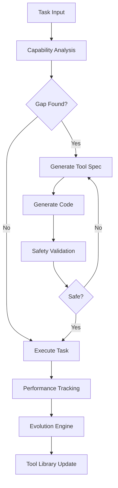

# 🧬 Self-Evolving MetaAgent: Complete Guide

## Table of Contents
1. [Introduction](#introduction)
2. [How It Works](#how-it-works)
3. [Architecture](#architecture)
4. [Safety Mechanisms](#safety-mechanisms)
5. [Usage Examples](#usage-examples)
6. [Tool Evolution](#tool-evolution)
7. [API Reference](#api-reference)
8. [Best Practices](#best-practices)
9. [Troubleshooting](#troubleshooting)

## Introduction

The Self-Evolving MetaAgent represents a paradigm shift in autonomous AI systems. Unlike traditional agents that are limited by pre-programmed capabilities, this agent can:

- **Identify** what tools it needs for any task
- **Generate** new tools using LLM-powered code synthesis
- **Validate** tools in secure sandboxed environments
- **Evolve** tools based on real-world performance
- **Persist** successful tools for future use

This is the first open-source implementation of truly self-improving AI agents.

## How It Works

### 1. Capability Gap Analysis

When given a task, the agent first analyzes what capabilities are required:

```python
# The agent decomposes the task
task = "Analyze sentiment in customer reviews from multiple CSV files"

# Identifies required capabilities:
# - CSV file reading
# - Text parsing
# - Sentiment analysis
# - Data aggregation
# - Report generation
```

### 2. Tool Generation Pipeline

If capabilities are missing, the agent generates tools:

```python
# Agent realizes it lacks CSV parsing
# Generates a tool specification
spec = {
    "name": "csv_sentiment_analyzer",
    "purpose": "Parse CSV files and analyze sentiment",
    "params": ["file_path", "text_column"],
    "expected_output": "sentiment scores"
}

# Generates safe implementation
tool_code = await generator.create_tool(spec)
```

### 3. Safety Validation

All generated code goes through rigorous safety checks:

- **Static Analysis**: Forbidden patterns detection
- **Sandboxing**: Isolated execution environment
- **Resource Limits**: Memory and CPU constraints
- **Import Restrictions**: Only safe libraries allowed

### 4. Evolution Through Experience

Tools improve based on usage:

```python
# Initial tool: 70% success rate
# After 3 iterations: 95% success rate
# Evolution includes:
# - Better error handling
# - Performance optimization
# - Edge case coverage
```

## Architecture

### Core Components

```
SelfEvolvingMetaAgent
├── CapabilityAnalyzer      # Identifies what's needed
├── SafeCodeGenerator       # Creates tool implementations
├── SafetyValidator         # Ensures code safety
├── EvolutionEngine        # Improves tools over time
└── EvolvingToolLibrary    # Manages tool versions
```

### Tool Generation Flow



## Safety Mechanisms

### 1. Code Generation Constraints

```python
FORBIDDEN_PATTERNS = [
    'exec(', 'eval(', '__import__',
    'subprocess', 'os.system',
    'open(.*w)',  # No file writes
    'compile(', 'globals(', 'locals('
]
```

### 2. Sandboxed Execution

```python
# Limited namespace
sandbox = {
    '__builtins__': {
        'print': print,
        'len': len,
        'str': str,
        # Only safe built-ins
    }
}

# Resource limits
limits = {
    'memory': '100MB',
    'cpu_time': '5s',
    'network': 'restricted'
}
```

### 3. Human-in-the-Loop

High-risk tools require approval:

```python
if risk_score > 0.7:
    await request_human_approval(tool)
```

## Usage Examples

### Basic Usage

```python
from browser_use.architect.agents.self_evolving_meta_agent import SelfEvolvingMetaAgent

# Create agent
agent = SelfEvolvingMetaAgent(
    goal="Extract insights from unstructured data"
)

# Run - it will create whatever tools it needs!
result = await agent.run()

print(f"Tools created: {result['tools_generated']}")
print(f"Result: {result['result']}")
```

### Advanced Usage with Callbacks

```python
async def progress_callback(event_type, data):
    if event_type == "tool_generated":
        print(f"🔧 New tool: {data['name']}")
    elif event_type == "tool_evolved":
        print(f"📈 Improved: {data['name']} (+{data['improvement']}%)")

result = await agent.run(callback=progress_callback)
```

### Persistent Tool Library

```python
# Tools persist across sessions
agent1 = SelfEvolvingMetaAgent("Task 1")
await agent1.run()  # Creates tools A, B

agent2 = SelfEvolvingMetaAgent("Task 2")
agent2.tool_library = agent1.tool_library  # Reuse tools!
await agent2.run()  # Uses A, B, creates C
```

## Tool Evolution

### Evolution Triggers

Tools evolve when:
1. Success rate < 80%
2. Execution errors occur
3. Performance degrades
4. New edge cases found

### Evolution Process

```python
# Original tool (v1)
async def extract_emails(text):
    return re.findall(r'\S+@\S+', text)
    
# Evolved tool (v2) - handles edge cases
async def extract_emails(text):
    pattern = r'\b[A-Za-z0-9._%+-]+@[A-Za-z0-9.-]+\.[A-Z|a-z]{2,}\b'
    emails = re.findall(pattern, text)
    return [e for e in emails if validate_email(e)]
```

### Cross-Pollination

Successful patterns from one tool can improve others:

```python
# Error handling pattern from tool A
try:
    result = process()
except Exception as e:
    return {"error": str(e), "fallback": default}

# Applied to tool B automatically!
```

## API Reference

### SelfEvolvingMetaAgent

```python
class SelfEvolvingMetaAgent(BaseAgent):
    def __init__(self, goal: str, model: str = "gemini-1.5-pro")
    
    async def run(self, callback: Optional[Callable] = None) -> Dict[str, Any]
    
    # Returns:
    {
        "status": "success",
        "result": Any,
        "tools_generated": int,
        "execution_time": float,
        "capabilities_learned": List[str]
    }
```

### Tool Library

```python
class EvolvingToolLibrary:
    def add(self, tool: Dict[str, Any])
    def get_tool(self, name: str) -> Optional[Dict]
    def get_capabilities(self) -> List[str]
    def rollback(self, tool_id: str, version: str)
```

## Best Practices

### 1. Start Simple

Let the agent learn incrementally:

```python
# Good: Start with basic task
"Parse this CSV file"

# Then increase complexity
"Parse CSV and generate visualizations"
```

### 2. Provide Clear Goals

Be specific about expected outcomes:

```python
# Good
"Extract email addresses and validate them against RFC 5322"

# Too vague
"Process this data"
```

### 3. Monitor Evolution

Track tool performance:

```python
for tool_name, metrics in agent.tool_performance.items():
    print(f"{tool_name}: {calculate_success_rate(metrics)}")
```

### 4. Share Tool Libraries

Reuse tools across agents:

```python
# Save tool library
with open('tools.json', 'w') as f:
    json.dump(agent.tool_library.export(), f)

# Load in another agent
new_agent.tool_library.import_from(json.load(f))
```

## Troubleshooting

### Common Issues

1. **Tool Generation Fails**
   - Check API key is set
   - Ensure task is clearly defined
   - Verify model has sufficient context

2. **Safety Validation Errors**
   - Review forbidden patterns
   - Check import restrictions
   - Ensure code follows constraints

3. **Evolution Not Triggering**
   - Need minimum 3 executions
   - Success rate must be < 80%
   - Check performance tracking

### Debug Mode

```python
# Enable detailed logging
import logging
logging.getLogger('browser_use.architect').setLevel(logging.DEBUG)

# Track tool generation
agent.debug_mode = True
```

### Performance Tips

1. **Cache Tool Libraries**: Reuse across sessions
2. **Batch Similar Tasks**: Leverage learned tools
3. **Monitor Memory**: Clean old tool versions
4. **Use Appropriate Models**: Fast models for simple tools

## Future Enhancements

### Planned Features

1. **Distributed Tool Sharing**: Share tools across instances
2. **Tool Marketplace**: Community-contributed tools
3. **Advanced Evolution**: Genetic algorithms
4. **Multi-Modal Tools**: Image/video processing
5. **Tool Composition**: Combine simple tools

### Research Directions

- Formal verification of generated tools
- Adversarial tool generation
- Cross-language tool synthesis
- Quantum-inspired evolution algorithms

---

## Conclusion

The Self-Evolving MetaAgent represents a fundamental breakthrough in autonomous AI. By enabling agents to create and improve their own tools, we've removed the primary limitation of traditional systems - fixed capabilities.

This is just the beginning. As the community contributes and the system evolves, we expect to see emergent capabilities we haven't imagined yet.

**Welcome to the future of autonomous AI!** 🚀